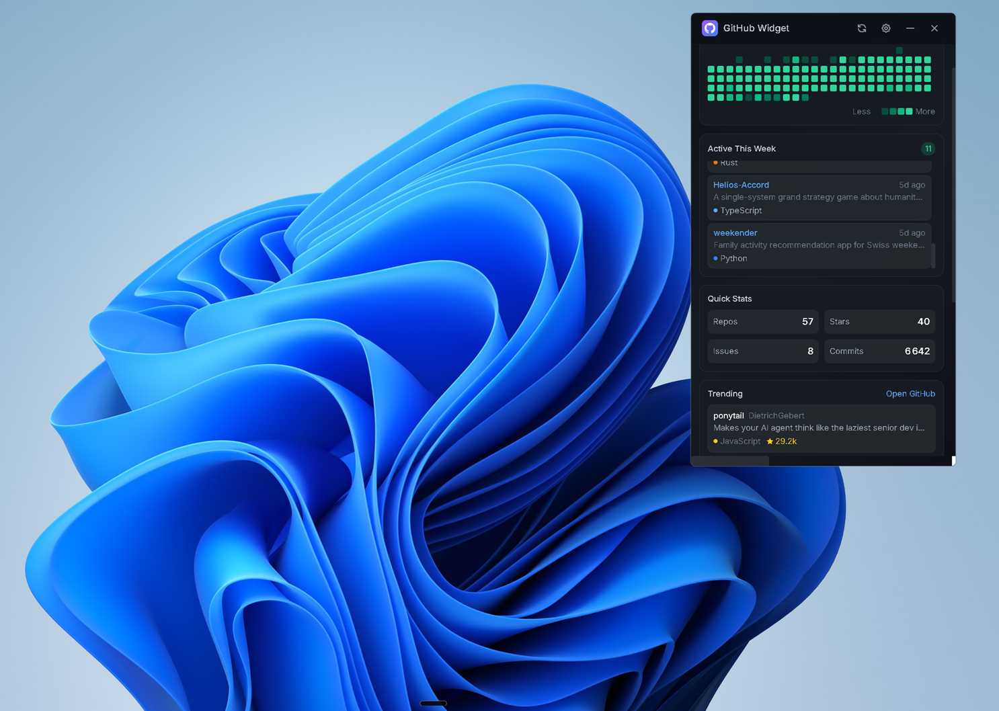

# GitHub Widget Desktop

A lightweight GitHub dashboard widget for Windows — always accessible on your desktop, hides to the system tray when minimized or closed.

## Screenshots



## Features

- **Activity heatmap** — commit history visualization across all your repos (cached locally)
- **Active repos** — recently pushed repositories with language, stars, and issues
- **Quick stats** — total repos, stars, open issues, and contributions
- **Trending repos** — today's trending GitHub projects
- **Two refresh modes**:
  - **Quick refresh** (🔄) — fetches recent events and merges with cached activity. Fast, no rate limit pressure.
  - **Full sync** (⟳) — scans every repo's commit history to build a complete activity map. Runs on first launch, then only fetches deltas.
- **System tray integration** — double-click tray icon to restore, right-click for menu
- **Custom title bar** — minimize and close buttons (hide to tray, don't quit)
- **Toggle always-on-top** — right-click tray → Toggle Always on Top

## Setup

```bash
cd github-widget-desktop
npm install
npm run build
```

## Usage

```bash
npm run dev     # development mode
npm run build   # build .exe installer
```

- Run `dist\GitHub Widget Setup 1.0.0.exe` to install, or
- Run `dist\win-unpacked\GitHub Widget.exe` directly for portable use

## Controls

| Action | Result |
|--------|--------|
| 🔄 button | Quick refresh — recent events only, merged with cache |
| ⟳ button | Full sync — scan every repo, rebuild complete activity map |
| ⚙ button | Settings — GitHub username and personal access token |
| Minimize / Close button | Hides to system tray |
| Double-click tray icon | Restore widget |
| Right-click tray icon | Show menu (Show, Toggle Always on Top, Quit) |

## Notes

- A GitHub token with `repo` scope is required to access private repositories and to avoid rate limits. Get one at GitHub → Settings → Developer Settings → Personal Access Tokens.
- The full sync may take a few minutes the first time (it iterates all your repos and pulls commit history). Subsequent quick refreshes only fetch the delta.
- Activity data is cached in `localStorage` so it persists between launches.

## Testing

```bash
npm test               # contract tests (no network, runs on every commit)
npm run test:integration  # live tests against GitHub API (28 tests)
npm run test:all       # both
```

A pre-commit hook runs the contract tests on every commit. If a regression is detected, the commit is blocked. Bypass with `git commit --no-verify` only if absolutely necessary.

The contract tests are the regression guards for bugs that shipped in earlier versions:
- Wrong API path (`/repos/` prefix required)
- Listener leak in preload (singleton pattern required)
- Missing HTTP status code check (4xx errors must reject, not resolve)

## Recent Changes

- [1.0.3] Fix activity map month labels (CSS Grid so labels line up with their week column) and trending repos (now scrapes github.com/trending daily feed with search-API fallback) (2026-06-17)
- [1.0.2] Add contract + integration tests, pre-commit hook guards regressions (2026-06-17)
- [1.0.1] Fix full sync API path (`/users/{u}/repos/{r}/commits` → `/repos/{u}/{r}/commits`) and fix listener leak in preload (2026-06-17)
- [1.0.0] Initial release — Electron desktop widget with activity map, active repos, quick stats, trending repos, and system tray integration (2026-06-16)